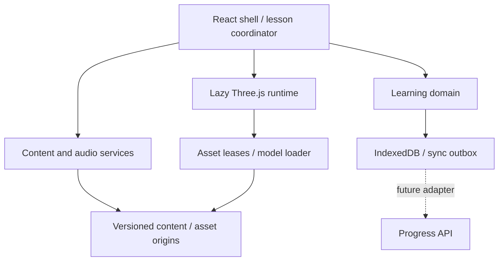

# Arxitektura

## Chegaralar

React ilovasi foydalanuvchi interfeysi va session koordinatoridir. Renderer har freymda React state yangilamaydi. Engine Reactga bog‘liq emas. Learning domeni Three.js, React yoki DOM import qilmaydi; IndexedDB alohida infratuzilma adapteri. Contracts barcha qatlamlar uchun import qilinadigan eng quyi paket.

## Level, sahna va dunyo

- Curriculum topic: pedagogik reja. Hozir 204 outline; bu playable level emas.
- Lesson/level: bitta maqsad atrofidagi tasdiqlangan vazifalar ketma-ketligi, metadata.
- Pack: ko‘pi bilan 100 level, HTTP bilan talab bo‘yicha keladi.
- Scene: qayta ishlatiladigan joy, model references, transform va collider metadata.
- Asset: hash bilan versiyalangan model yoki ovoz. Leveldan mustaqil.

10k level yangi joylar sonini majburan oshirmaydi. Masalan, bir uy turli vaqtda rang, miqdor, predlog, odat va voqea uchun ishlatiladi. O‘quv natijasi parametrlarga ta’sir qiladi; bir xil tugma ketma-ketligi javob bo‘lmasligi kerak.

## Scene lifecycle

1. Scene JSON schema tekshiriladi; required GLBlarning statusi tekshiriladi.
2. Yangi sahna ekrandan tashqarida tayyorlanadi. Modellar ketma-ket olinadi: dekodlash concurrency chegaralangan.
3. Cache bir assetga parallel talablarni bir yuklashga birlashtiradi; har foydalanish Lease oladi.
4. Rootlar SkeletonUtils orqali nusxalanadi; geometriya/materiallar umumiy, skeletonlar instancega tegishli.
5. Animatsiya xaritasi va player spawn tekshiriladi.
6. Hammasi muvaffaqiyatli bo‘lsa sahna atomik almashtiriladi. Eski mixerlar, clone skeletonlar, shadow resurslari va leases bo‘shatiladi.
7. Xato yoki yangi transition bo‘lsa tayyorlanayotgan scope tozalanadi. Cache keyinchalik LRU orqali tozalanadi.
8. Engine yopilganda resize/input/render loop va barcha own resurslar tozalanadi.

In-flight GLB fetch hozir umumiy cache jobga tegishli va scene bekor bo‘lganda individual abort qilinmaydi; timeout bor. Natija keyin kelsa engine yopilganligini tekshirib dispose qiladi. Bu deliberate ownership qarori; katta ko‘lamda refcounted fetch cancellation alohida optimallashtirish bo‘ladi.

## Memory budget

`residentBytes` — importda beriladigan konservativ **taxmin**, compressed GLB fayl hajmi emas. Textura GPU xotirasi, mipmaps, vertex/bone bufferlar va animatsiyalar hisobga olinadi. Default asset cache taxmin byudjeti 192 MiB; bu umumiy browser/GPU hard cap emas. Decoder, render target, shadow, renderer va JS overhead alohida. Haqiqiy o‘lchov bilan konfiguratsiya o‘zgartiriladi.

Active resurslar evict qilinmaydi. Yangi sahna + eski sahna birga byudjetga sig‘masa transition rad etiladi; yashirincha haddan ortiq xotira ishlatilmaydi. Bunday holatda asset hajmi qisqartiriladi, yengil transition scene qo‘llanadi yoki qurilma sinfi uchun byudjet qayta baholanadi.

## Controller chegarasi

Hozir tekis yer, x/z bo‘yicha yurish, radiusli player va authored static AABB bor. Ko‘rinadigan collision mesh yasalmaydi. Tepalik, zinapoya, sakrash, dinamik rigid body va navmesh hali yo‘q. Ushbu ehtiyojlar kelganda kinematic physics adapter, masalan alohida tekshirilgan Rapier versiyasi, domen chegarasida qo‘shiladi. Modelning visual meshini collision solver sifatida har freymda to‘liq tekshirmaymiz.

## Audio ownership

Bitta narration kanali. Yangi cue oldingisini bekor qiladi; har bir pending promise yakunlanadi. HTMLAudio streaming uzun yozuvlarning barchasini WebAudio bufferga dekodlamaydi. UI faqat status va subtitrni oladi. Background music, SFX kanallari va ducking keyingi audio mixer qatlamiga qoldirilgan.

## Saqlash va sync

Evidence ID idempotency key. Attempts, mastery va outbox bir IndexedDB transactionda yoziladi. Out-of-order yoki texnik xato masteryga soxta yutuq bermaydi. Server sync adapteri hozir yo‘q; outbox borligi cloud backup degani emas. Brauzer ma’lumoti tozalansa progress yo‘qolishi mumkin.
